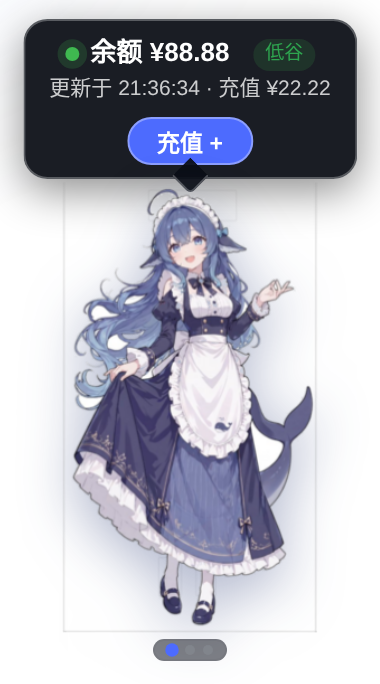

# dsh-whale-pet 🐳

[English](README.en.md) · [安装](docs/INSTALL.md) · [架构](docs/ARCHITECTURE.md) · [更新日志](CHANGELOG.md)

`dsh-whale-pet` 是 DeepSeek Harness Web GUI 的鲸鱼娘（Whale-chan）悬浮宠物插件。它显示账户余额与消费、OpenCode Go 套餐额度、真实任务进度与按模型计费的完成弹窗；也可以导入自己的 Cubism 3/4/5 Live2D 模型替换默认鲸鱼娘并进行动作交互。



> 截图使用固定示例数据（余额 ¥88.88），不包含真实账户信息。

## v0.4.1 功能

### Live2D 模型导入与交互

- 点击宠物右上角的 `⚙️` 打开 Live2D 设置。
- 支持导入 `.zip`：压缩包内须包含一个 `.model3.json` 及其 `.moc3`、贴图、物理、动作、表情等引用资源；可包含一个外层目录。
- 支持导入 HTTP/HTTPS `.model3.json` URL；资源服务器必须允许浏览器 CORS。导入时会下载引用资源，之后模型从当前浏览器的 IndexedDB 本地恢复。
- 支持 Cubism 3/4/5 的 `.model3.json`；不支持旧 Cubism 2 `.model.json`。
- 互动动作：鼠标移动控制视线/头部朝向，点击命中区域优先播放同名动作（常见为 `TapBody`），设置面板也可播放随机动作或随机表情；模型自身支持空闲动作、眨眼、呼吸和物理效果。
- 点击宠物右上角的 `⚙️` 打开设置不会切换页面，方便随时调整；设置面板内的「宠物大小」滑块（50%–200%）可只缩放宠物模型，气泡与对话框保持原尺寸，并会记住选择、可一键恢复默认。
- 导入失败、模型不完整或 WebGL 不可用时保留默认 PNG，不会阻止整个 DSH 插件启动；可随时移除模型恢复默认鲸鱼娘，并可在同一页面重新导入。每次 Live2D 挂载都会创建独立 canvas，避免复用 PIXI 已销毁的 WebGL context。
- 官方 Cubism Core 作为本地运行时随插件提供并由同源路由加载，运行时不依赖外部 CDN；PIXI/Live2D 渲染器仅在实际使用 Live2D 时动态加载。
- ZIP 解包与校验在独立 Worker 中执行，页面隐藏时暂停 Live2D ticker；URL 导入限制为最多 256 个资源、单文件 32 MiB、总计 128 MiB、并发 4 个请求。
- 模型配置与资源现在共用一个 IndexedDB 原子记录，不再依赖可能与模型数据分叉的 localStorage 指针。

### 桌面伴侣安全配对

- 在 `⚙️` 设置的「桌面伴侣配对」区为每台 PowerShell/Rust 伴侣生成独立令牌；明文只显示一次，宿主只保存摘要。
- 已配对设备可单独撤销；伴侣数据路由同时要求 loopback socket、可信 Host/Origin 和 `Authorization: Bearer …`。
- PowerShell 使用当前 Windows 用户的 DPAPI 存储令牌；Rust 使用 Windows Credential Manager。令牌不得放入 URL、查询参数、日志或截图。

> 请仅导入你有权使用的模型、贴图、动作、表情与音频。Live2D Cubism Core 的独立许可与来源见 [素材说明](ASSET_NOTICE.md)。

### 余额与消费（合并页）

- 宿主通过 DSH credentials 读取 `DEEPSEEK_API_KEY` 并查询余额；密钥不会进入浏览器。
- 余额与今日/近 7 天消费显示在同一页；金额严格按账户余额下降累计。
- 充值或赠金导致的余额上升只更新计算基线，不抵扣已累计消费；首次成功读取余额只建立基线。

### OpenCode Go 套餐额度

- 独立页面显示滚动 5 小时、7 天、1 个月窗口的已用、剩余、状态与重置时间。
- 凭证优先 `OPENCODE_GO_API_KEY`，回退 opencode CLI 登录文件 `~/.local/share/opencode/auth.json` 的 `opencode-go.key`；密钥不出宿主。
- 宿主做 30 秒缓存与并发合并；失败时回退上次成功数据。

### 任务与完成弹窗

- 自动发现最多 10 个运行中会话；子代理任务行嵌套在主任务容器下，超过 5 条时滚动。
- `approval/asked` 让状态点变黄；`approval/decided` 立即清除黄点。
- 完成对话框分别展示本次对话与对话总消耗量，每条消息按其实际模型和发生时价格估算。

### 鲸鱼娘与刷新

- 拖拽与位置记忆、点击切页、明暗背景自适应、高峰/低谷提示、充值入口。
- 余额与消费每 60 秒刷新；任务进度按较短间隔更新；OpenCode Go 页面每 60 秒刷新。

## 安装

要求：Node.js 24+、可运行的 DSH CLI，且 `pnpm` 在 `PATH` 中。

从 [GitHub Releases](https://github.com/ali8772/dsh-web-gui/releases) 下载 `dsh-whale-pet-0.4.1.tgz`：

```sh
dsh plugin --profile web add ./dsh-whale-pet-0.4.1.tgz
```

重启 `dsh web`，再刷新浏览器。不要在 profile patch 中重复插入插件；安装包自带 bundle patch。升级、卸载与验证见 [安装文档](docs/INSTALL.md)。

## 宿主路由

| 路径 | 用途 |
|---|---|
| `GET /api/whale-pet/health` | 存活检查，返回 `{ plugin, version, ok }` |
| `GET /api/whale-pet/state` | 余额 + 今日/近 7 天消费 + 调用次数；DSH 浏览器认证 |
| `POST /api/whale-pet/tasks` | 真实任务进度与等待授权状态；最多 32 个唯一会话 ID |
| `POST /api/whale-pet/task-summary` | 单会话 token/费用汇总，按模型分别计费 |
| `GET /api/whale-pet/opencode-go` | OpenCode Go 套餐额度 |
| `GET/POST /api/whale-pet/companions*` | 已认证浏览器列出、签发和撤销桌面伴侣 grant |
| `/dsh-whale-pet/companion/v1/*` | loopback + Bearer 的 state/tasks/task-summary/opencode-go 伴侣路由 |
| `GET /dsh-whale-pet-live2dcubismcore.min.js` | 本地 Cubism Core 运行时，仅使用 Live2D 时加载 |
| `GET /dsh-whale-pet-live2d.js` | PIXI/Live2D 动态渲染器 |
| `GET /dsh-whale-pet-live2d-zip-worker.js` | ZIP 解包与模型校验 Worker |

## 数据与隐私

- 凭证始终留在宿主；任何路由都不会返回原始密钥。
- 余额账本位于 `$DSH_HOME/whale-pet/balance-spend.json`，只存币种、上次余额与按日累计下降额。
- 会话日志仅用于调用次数、任务进度与按模型计费。
- 导入的 Live2D 模型保存在当前浏览器的 IndexedDB，不上传给插件宿主或第三方。URL 导入阶段浏览器会直接请求用户填写的模型服务器。
- ZIP 解压限制为最多 2,048 个文件、解压后 256 MiB，并拒绝绝对 URL/路径和逃出包根目录的资源引用；URL 导入另有 256 文件/32 MiB 单文件/128 MiB 总量限制。
- 私有浏览器路由统一走 DSH Host/Origin 与浏览器会话认证，64 KiB 请求体上限；任务批次中的损坏日志被隔离为单行错误，不拖垮其余结果。
- 桌面伴侣 token 明文只在签发响应出现一次；DSH credentials 中只保留 verifier，浏览器不会持久化 token。

不要把凭据、profile 文件、会话日志、真实账户截图或无权分发的 Live2D 模型提交到 Git。

## 验证

```sh
curl http://127.0.0.1:3080/api/whale-pet/health
# state/tasks 等私有路由须从已认证 DSH 浏览器访问；裸 curl 应返回 401
```

预期：

```json
{"plugin":"dsh-whale-pet","version":"0.4.1","ok":true}
```

## Windows 伴侣

`windows/` 包含 PowerShell/WPF 实验版，`windows-rust/` 包含独立 Rust 实验版；两者都不是 DSH bundle，也不随 npm 插件包运行。先在 Web 设置中生成各自的伴侣 grant，再按各目录 README 一次性导入 token。

## 开发

```sh
npm ci
npm run build
npm test
npm run typecheck
npm run check
npm run check:size
npm run audit:prod
npm pack --dry-run
```

完整说明见 [贡献指南](CONTRIBUTING.md)、[发布流程](docs/RELEASE.md) 与 [素材说明](ASSET_NOTICE.md)。

## 许可

项目代码采用 [MIT](LICENSE) 许可证。鲸鱼娘素材、Live2D Cubism Core 独立许可和商标说明见 [ASSET_NOTICE.md](ASSET_NOTICE.md)。项目与 DeepSeek 或 Live2D 官方无隶属或背书关系。
